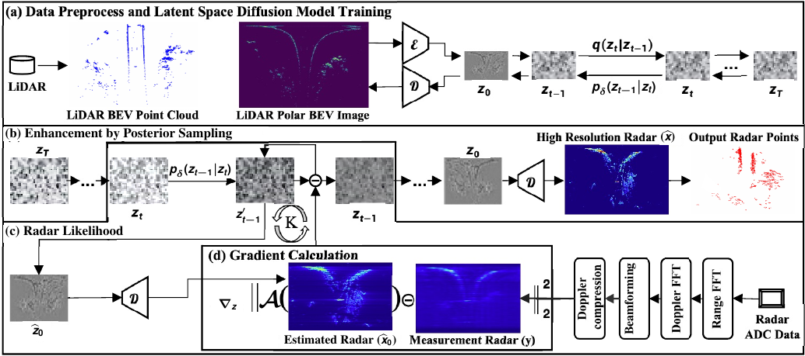
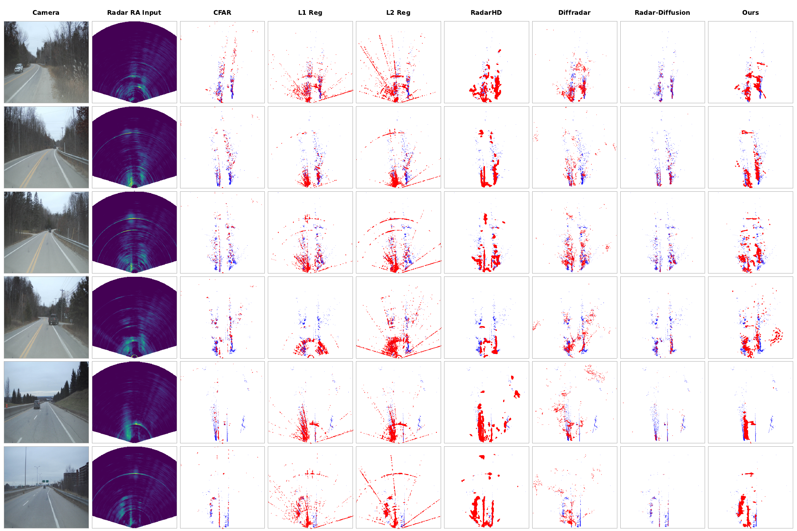

# RadarINV: Unsupervised Radar Range-Azimuth Super-Resolution via LiDAR Guided Diffusion Prior

[](https://arxiv.org/abs/2505.09887)
[](https://drive.google.com/drive/folders/1VAbZq6jY48dMbMbevolYWyxpfOBq-IDt)



RadarINV enhances the angular resolution of automotive radar **without paired radar–LiDAR training data**.
A latent diffusion prior is trained on LiDAR occupancy maps only. At inference, diffusion posterior sampling
pulls the sample towards the radar measurement through a differentiable radar forward operator `A(x)`.
The radar is used only at inference, so one prior serves different radar sensors (RADIal and K-Radar) without retraining.

## News

- **2026-11**: Code of the revised paper released: sampler, evaluation protocol, baselines and the scripts behind every table and figure.

## Installation

```bash
git clone https://github.com/yyxr75/RadarINV.git
cd RadarINV
conda env create -f environment_radarinv.yml      # creates env "radarinv" (torch 2.0.1, PL 1.9.5)
conda activate radarinv
export PYTHONPATH=$PWD:$PWD/src/taming-transformers:$PYTHONPATH
```

## Model Zoo

All weights are in the Google Drive folder [`RadarINV_weights_2026-10-22`](https://drive.google.com/drive/folders/1VAbZq6jY48dMbMbevolYWyxpfOBq-IDt).

| Model | Training data | File | Size | Place it at |
|---|---|---|---|---|
| VQ-VAE (first stage, shared by all priors) | RADIal LiDAR | `vq_radial_epoch323.ckpt` | 863 MB | `models/first_stage_models/epoch=000323.ckpt` |
| **LDM prior, all scenarios** (main model) | RADIal LiDAR, train split | `ldm_all_epoch098.ckpt` | 16.8 GB | `models/ldm/radial_ldm_epoch=000098.ckpt` |
| LDM prior, Countryside only | RADIal LiDAR, Countryside drives | `ldm_countryside_sd.ckpt` | 8.6 GB | `models/ldm/ldm_countryside_sd.ckpt` |
| LDM prior, City drives held out | RADIal LiDAR, three City drives removed | `ldm_all_cityheldout_sd.ckpt` | 8.6 GB | `models/ldm/ldm_all_cityheldout_sd.ckpt` |
| Radar-Diffusion baseline | RADIal radar–LiDAR pairs | `radardiff_radial_ema_025000.pt` | 136 MB | any path, see [Baselines](docs/REPRODUCE.md#7-baselines) |

The VQ-VAE and the main prior are all you need for inference. To download them:

```bash
pip install gdown
mkdir -p models/first_stage_models models/ldm
gdown --folder https://drive.google.com/drive/folders/1VAbZq6jY48dMbMbevolYWyxpfOBq-IDt -O weights   # whole folder (~35 GB)
mv weights/vq_radial_epoch323.ckpt "models/first_stage_models/epoch=000323.ckpt"
mv weights/ldm_all_epoch098.ckpt   "models/ldm/radial_ldm_epoch=000098.ckpt"
```

## Getting Started

**Demo.** Run the sampler on a RADIal frame shipped in `demo_data/` (no dataset download needed):

```bash
bash sample_radial.sh      # frame 000038, result in results_512x768/
```

**Datasets.** Download [RADIal](https://github.com/valeoai/RADIal) and [K-Radar](https://github.com/kaist-avelab/K-Radar),
then set `RADIAL_ROOT` and `KRADAR_ROOT`. The folders used and the data splits are listed in
[docs/REPRODUCE.md](docs/REPRODUCE.md#2-data).

**Inference on the test set, evaluation and the paper's tables.** See [docs/REPRODUCE.md](docs/REPRODUCE.md).

## Results

**RADIal** (424 test frames). CD, UCD and MHD in meters.

| Method | Supervised training | FID<sub>BEV</sub> ↓ | CD ↓ | UCD ↓ | MHD ↓ |
|---|:-:|:-:|:-:|:-:|:-:|
| CFAR | ✗ | 238.4 | 5.11 | 2.24 | 3.06 |
| L1 Reg | ✗ | 147.6 | 4.74 | 2.47 | 3.00 |
| L2 Reg | ✗ | 171.1 | 4.39 | 2.00 | 2.70 |
| RadarHD | ✓ | 192.2 | 3.84 | 1.76 | 2.75 |
| Diffradar | ✓ | 169.5 | 5.23 | 2.44 | 3.10 |
| Radar-Diffusion | ✓ | 143.6 | 3.94 | **0.44** | 3.51 |
| **RadarINV (ours)** | ✗ | **123.0** | **3.59** | 1.24 | **2.40** |

**K-Radar** (46 test frames, same prior, no method trained on K-Radar).

| Method | FID<sub>BEV</sub> ↓ | CD ↓ | UCD ↓ | MHD ↓ |
|---|:-:|:-:|:-:|:-:|
| CFAR | 799.0 | 25.05 | 7.76 | 17.33 |
| L1 Reg | 173.7 | 3.84 | 3.02 | 3.02 |
| L2 Reg | 170.1 | 3.29 | **1.63** | 1.95 |
| **RadarINV (ours)** | **159.9** | **3.09** | 1.80 | **1.90** |



## Citation

```bibtex
@misc{yang2025unsupervisedradarpointcloud,
      title={Unsupervised Radar Point Cloud Enhancement via Arbitrary LiDAR Guided Diffusion Prior},
      author={Yanlong Yang and Jianan Liu and Guanxiong Luo and Hao Li and Euijoon Ahn and Mostafa Rahimi Azghadi and Tao Huang},
      year={2025},
      eprint={2505.09887},
      archivePrefix={arXiv},
      primaryClass={cs.RO},
      url={https://arxiv.org/abs/2505.09887},
}
```

## Acknowledgement

This code builds on [latent-diffusion](https://github.com/CompVis/latent-diffusion) and
[taming-transformers](https://github.com/CompVis/taming-transformers). The Radar-Diffusion baseline uses
[Radar-Diffusion](https://github.com/ZJU-FAST-Lab/Radar-Diffusion). We thank the authors of
[RADIal](https://github.com/valeoai/RADIal) and [K-Radar](https://github.com/kaist-avelab/K-Radar) for the datasets.
